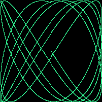
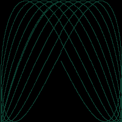
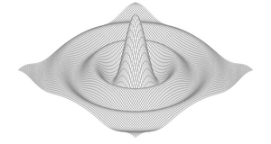
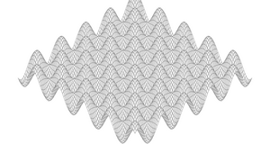
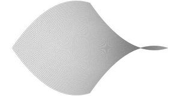
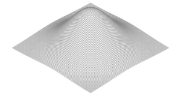
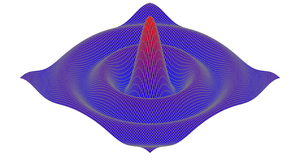
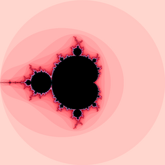
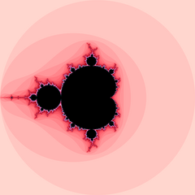
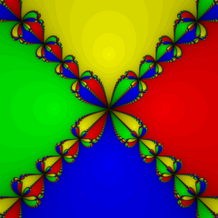

# learning-go

My solutions to the exercises from **The Go Programming Language** by A. Donovan & B. Kernighan.

## Structure

``` go
go.mod
ch01/
  ex1.1/main.go     one folder per exercise (one main per package)
  ex1.2/main.go
```

## Run

```sh
go run ./ch01/ex1.1 hello world
```

#### Gallery

| 1.5 Lissajous | 1.6 colored Lissajous |
|:---:|:---:|
|  |  |

| 3.1 surface | 3.2 egg box | 3.2 saddle | 3.2 hill |
|:---:|:---:|:---:|:---:|
|  |  |  |  |

| 3.3 colored surface | 3.5 Mandelbrot | 3.6 supersampling | 3.7 Newton |
|:---:|:---:|:---:|:---:|
|  |  |  |  |

## Progress

- [x] **1. Tutorial** (12/12)
- [x] **2. Program Structure** (5/5)
- [x] **3. Basic Data Types** (13/13)
- [ ] **4. Composite Types**
- [ ] **5. Functions**
- [ ] **6. Methods**
- [ ] **7. Interfaces**
- [ ] **8. Goroutines and Channels**
- [ ] **9. Concurrency with Shared Variables**
- [ ] **10. Packages and the Go Tool**
- [ ] **11. Testing**
- [ ] **12. Reflection**
- [ ] **13. Low-Level Programming**

## Table Of Contents

### Chapter 1 — Tutorial
- **1.1** — `echo` that prints `os.Args[0]`.
- **1.2** — `echo` that prints index + value per line.
- **1.3** — benchmark: concat vs `strings.Join`.
- **1.4** — `dup` that prints file names.
- **1.5** — Lissajous GIF via `image.GIF`.
- **1.6** — colored Lissajous GIF.
- **1.7** — `fetch` via `io.Copy`.
- **1.8** — `fetch` with auto `http://` prefix.
- **1.9** — `fetch` with HTTP status code.
- **1.10** — caching timing experiment.
- **1.11** — `fetchall` with error handling.
- **1.12** — Lissajous over HTTP.

### Chapter 2 — Program Structure
- **2.1** — `tempconv` with Kelvin.
- **2.2** — general unit converter CLI.
- **2.3** — `PopCount` via loop.
- **2.4** — `PopCount` via 64-bit shifts.
- **2.5** — `PopCount` via `x&(x-1)`.

### Chapter 3 — Basic Data Types
- **3.1** — 3-D surface SVG that skips non-finite polygons.
- **3.2** — surface with other functions: egg box, saddle, hill.
- **3.3** — surface colored by height (red peaks, blue valleys).
- **3.4** — surface SVG web server with width, height and color params.
- **3.5** — full-color Mandelbrot via `color.YCbCr`.
- **3.6** — Mandelbrot with 4x supersampling.
- **3.7** — Newton fractal for z⁴ − 1, colored by root.
- **3.8** — Mandelbrot in `complex64`, `complex128`, `big.Float`, `big.Rat` + benchmarks.
- **3.9** — Mandelbrot web server with x, y and zoom params.
- **3.10** — non-recursive `comma` via `bytes.Buffer`.
- **3.11** — `comma` for floats and an optional sign.
- **3.12** — anagram check.
- **3.13** — KB…YB constants in one line.


## License

[MIT](LICENSE) © 2026 Illiryca